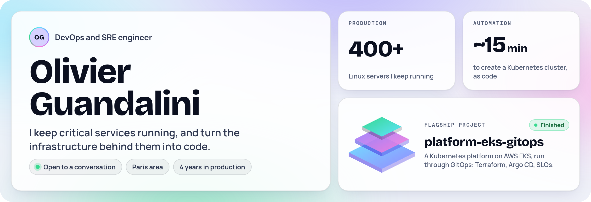
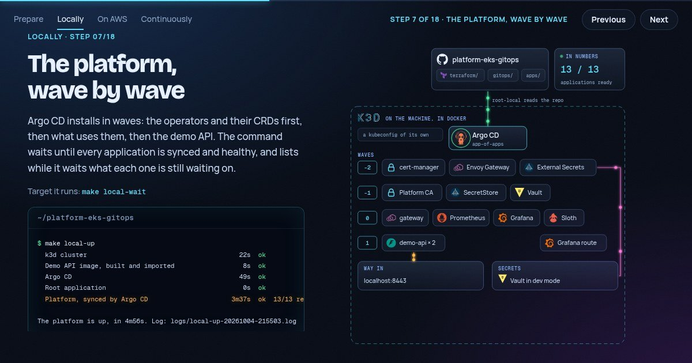
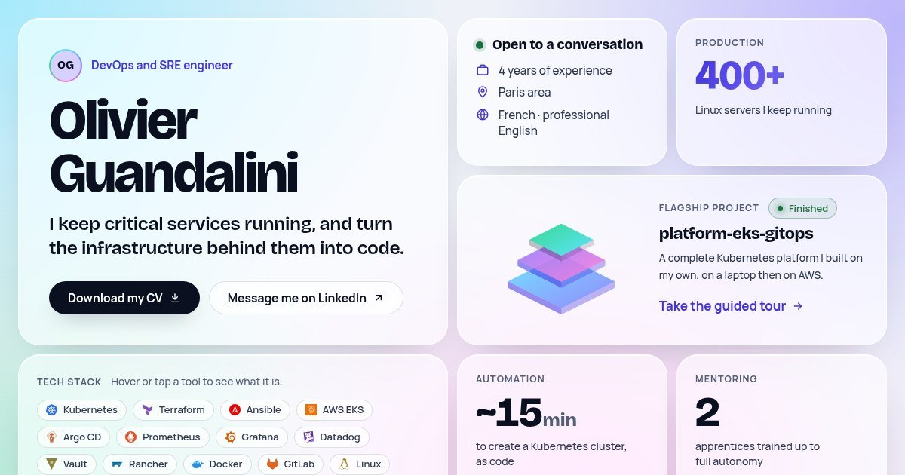

<a href="https://oguandalini.com/">
  <picture>
    <source media="(prefers-color-scheme: dark)" srcset="assets/banner-dark.png">
    
  </picture>
</a>

  <a href="https://oguandalini.com/"><b>oguandalini.com</b></a>
  &nbsp;·&nbsp;
  <a href="https://www.linkedin.com/in/ogu"><b>LinkedIn</b></a>
  &nbsp;·&nbsp;
  <a href="https://oguandalini.com/platform-eks-gitops/"><b>Guided tour</b></a>

DevOps and SRE engineer, I run critical infrastructure at scale: more than 400 Linux servers
on-prem and Kubernetes clusters. Here, the platforms I build on my own time, end to end: from
Terraform to GitOps, SLOs and runbooks.

## Projects

<table>
  <tr>
    <td width="50%" valign="top">
      
      <h3><a href="https://github.com/Olivg92/platform-eks-gitops">platform-eks-gitops</a></h3>
      
A GitOps Kubernetes platform on AWS EKS, also run on a laptop with k3d: Terraform, Argo CD, Vault and External Secrets, Prometheus and Grafana, SLOs with burn-rate alerts.

      
<a href="https://oguandalini.com/platform-eks-gitops/">Guided tour, in 18 steps</a> · <a href="https://github.com/Olivg92/platform-eks-gitops">Code</a>

    </td>
    <td width="50%" valign="top">
      
      <h3><a href="https://github.com/Olivg92/portfolio-site">portfolio-site</a></h3>
      
My portfolio site, in English and French: static pages checked on every pull request (links, types, Lighthouse), then deployed to GitHub Pages.

      
<a href="https://oguandalini.com/">Visit the site</a> · <a href="https://github.com/Olivg92/portfolio-site">Code</a>

    </td>
  </tr>
</table>

## Tech stack

<table>
  <tr>
    <td><b>Cloud and IaC</b></td>
    <td>
      
      
      
      
    </td>
  </tr>
  <tr>
    <td><b>Kubernetes and GitOps</b></td>
    <td>
      
      
      
      
      
    </td>
  </tr>
  <tr>
    <td><b>Observability</b></td>
    <td>
      
      
      
      
      
    </td>
  </tr>
  <tr>
    <td><b>CI/CD</b></td>
    <td>
      
      
      
      
    </td>
  </tr>
  <tr>
    <td><b>Systems</b></td>
    <td>
      
      
      
      
    </td>
  </tr>
</table>

Open to a conversation: <a href="https://www.linkedin.com/in/ogu">write to me on LinkedIn</a>.

